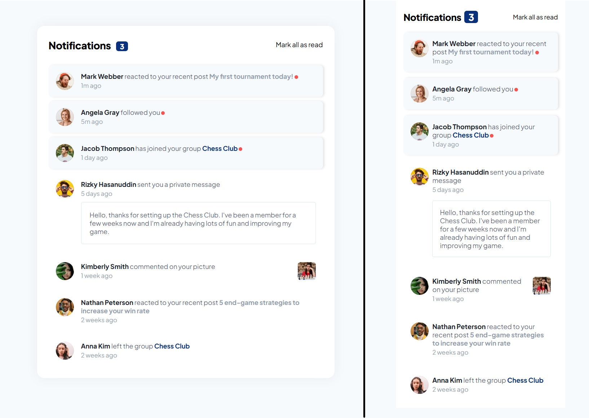

# Frontend Mentor - Notifications page

A responsive notifications page built with HTML, CSS, and vanilla JavaScript for the [Frontend Mentor challenge](https://www.frontendmentor.io/challenges/notifications-page-DqK5QAmKbC). It starts with three unread notifications and lets users mark all seven as read or unread with one keyboard-accessible button.

## Table of contents

- [Overview](#overview)
  - [Features](#features)
  - [Screenshot](#screenshot)
  - [Links](#links)
- [Built with](#built-with)
- [Running locally](#running-locally)
- [What I learned](#what-i-learned)
- [Continued development](#continued-development)
- [Commit guidelines](#commit-guidelines)
- [Author](#author)

## Overview

### Features

- A main landmark, one page heading, and a semantic list of seven notifications.
- A native button that works with a mouse, Enter, or Space and has a visible keyboard focus indicator.
- An unread count derived from notification state: initially 3, then 0 after marking everything read, then 7 after marking everything unread.
- Unread labels for screen readers, decorative red dots, and a live status message after each action.
- A mobile-first layout with a centered desktop card and locally hosted Plus Jakarta Sans font.

Names, post titles, the group name, and the private-message preview are static content in this standalone challenge. They have no navigation destinations or actions, so they do not show misleading hover or pointer styles.

### Screenshot



This is the existing capture of the solution before the accessibility and layout fixes. The supplied design references are separate files in `design/`. A fresh screenshot is still needed; browser capture was unavailable during this update.

### Links

- [Source code](https://github.com/pettik/FrontendMentor--notifications-page)
- [Live site](https://pettik-notifications-page.netlify.app/)

## Built with

- Semantic HTML5
- CSS custom properties, Flexbox, and a mobile-first media query
- Local variable font with `@font-face`
- Vanilla JavaScript and the DOM API
- Native keyboard controls, `:focus-visible`, screen-reader text, and a live status region

## Running locally

No dependencies or build step are required. Open `index.html` in a browser, or serve the repository with Python:

```sh
python -m http.server 8000 --bind 127.0.0.1
```

Then open `http://127.0.0.1:8000`.

To check the interaction, use Tab to focus **Mark all as read** and press Enter. The count should change from 3 to 0 and the unread backgrounds and dots should disappear. Press Space on **Mark all as unread** to set the count to 7. Check that the focus outline remains visible and that a screen reader announces the result.

## What I learned

- **Valid markup affects layout and reading order.** Nesting a paragraph inside another paragraph makes the browser close it automatically. The private-message summary, timestamp, and preview now use sibling paragraphs.
- **One state should drive the interface.** The `is-unread` class controls each notification's background, dot, and accessible unread label. JavaScript derives the count and next button action from those classes rather than comparing button text.
- **Hidden elements can still affect spacing.** `visibility: hidden` reserves room for a dot. Using `display: none` for read notifications removes both the dot and its layout space.
- **Accessibility starts with native elements.** A button supplies keyboard behavior without custom key handlers. A live status region announces changes, and static text no longer looks interactive.
- **Responsive layouts need flexible sizing.** A fluid card with a maximum width, a wrapping header, and shrinkable text columns replaces the fixed mobile width and desktop translation. Timestamps also use a darker color to improve contrast.

## Continued development

- Replace the existing screenshot with fresh desktop and mobile captures of the updated page.
- Complete browser and screen-reader checks at 320px, 375px, 768px, and 1440px, including 200% zoom and both button states.
- If the challenge grows into an application, add real destinations for profiles, posts, pictures, and messages before making them interactive.
- Consider individual read controls and persisted state if those interactions become part of the scope.

## Commit guidelines

Group a coherent behavior change with its related markup and styling. Use descriptive messages such as `Fix notification semantics and keyboard controls` or `Center the responsive notifications card` instead of `Update style.css` or `next changes`. Publish these fixes as focused commits without rewriting the existing shared history.

## Author

- GitHub - [Petr Bednarski](https://github.com/pettik)
- Frontend Mentor - [@pettik](https://www.frontendmentor.io/profile/pettik)
